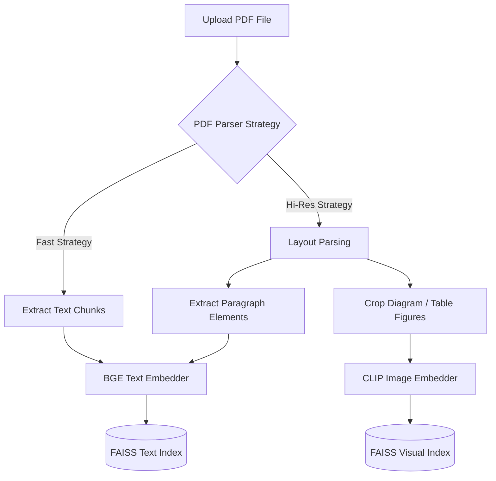
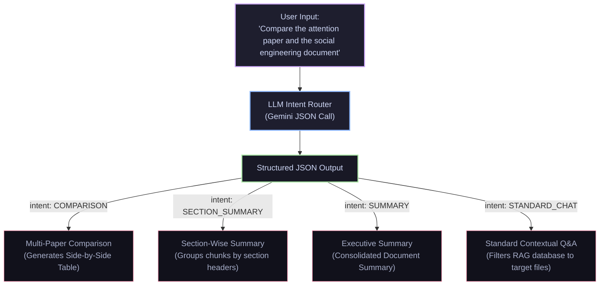

# 📚 Production-Grade Multimodal Multi-PDF Research Assistant (RAG)

A professional, modular Research Paper analysis assistant driven by **Retrieval-Augmented Generation (RAG)**. This system supports layout-aware PDF ingestion, dual-store FAISS indexing (Text + Diagrams/Charts), cross-encoder reranking, and an intelligent LLM-based query intent router.

---

## 🛠️ 1. System Architecture

The following diagram illustrates the hybrid RAG retrieval pipeline and visual processing flow:



### Ingestion & Parsing Strategy
1. **`fast` Strategy (PyPDF):** Extracts raw text sequentially in milliseconds; best suited for text-heavy PDFs.
2. **`hi_res` Strategy (Layout Parser + YOLOX + OCR):** Detects structured layout components (headers, paragraphs, tables, images). Standalone tables and figures are cropped as separate image files.

### Chunker & Chunker-by-Title
Rather than arbitrary token length boundaries, our chunker groups text using section header titles. This prevents logical context loss (like mathematical descriptions being detached from their formulas).

### Dual-Store FAISS Database
1. **Text Store (1024-dim):** Embeds text chunks via `BAAI/bge-large-en-v1.5` on GPU/MPS into a FlatIP index.
2. **Visual Store (512-dim):** Embeds cropped layout figures via CLIP `clip-ViT-B-32`, storing visual coordinates.

---

## 🤖 2. LLM Intent Router & Context Filtering

All incoming queries pass through a Gemini-based **Intent Router**. Rather than executing a blind vector similarity search, the router parses references, applies document filters, and selects the ideal execution pipeline:



---

## 🛡️ 3. High-Availability LLM Gate Architecture

To ensure zero downtime when running under restricted free-tier API quotas, all LLM requests are managed by a **Unified LLM Gate Handler**. If the primary gate fails (due to 429 quota exhaustion or rate limits), the handler dynamically redirects subsequent queries to the secondary gate without user intervention.

```mermaid
graph TD
    subgraph Client Application Layer
        AppCore["Router / Answering / Summarizer / Comparison"]
    endComplexity

    subgraph LLM Gate Layer
        AppCore -->|Unified generate call| GateHandler["LLM Gate Handler"]
        
        GateHandler -->|Gate 1| GeminiGate["Gemini Provider"]
        GeminiGate -->|429 / Quota Failure| GateHandler
        
        GateHandler -->|Gate 2: Auto Failover| ORGate["OpenRouter Provider"]
    end
    
    style AppCore fill:#1e1e2e,stroke:#cba6f7,stroke-width:2px,color:#cdd6f4
    style GateHandler fill:#181825,stroke:#89b4fa,stroke-width:2px,color:#cdd6f4
    style GeminiGate fill:#11111b,stroke:#f38ba8,stroke-width:1px,color:#a6adc8
    style ORGate fill:#11111b,stroke:#a6e3a1,stroke-width:1px,color:#a6adc8
```

---

## ⚠️ 4. Technical Challenges Faced & Solutions

During development, several critical concurrency, resource, and thread-safety issues were identified and resolved to make the application production-grade:

### Challenge 1: PyTorch CPU Segmentation Faults on macOS (Apple Silicon)
* **Problem:** Under heavy load, running PyTorch CPU thread-pools alongside Hugging Face `tokenizers`' native Rust multiprocessing caused a hard segmentation fault (`[1] segmentation fault python3 main.py query`) and leaked semaphore locks.
* **Solution:** 
  1. Configured `os.environ["TOKENIZERS_PARALLELISM"] = "false"` to prevent concurrent Rust-level fork conflicts.
  2. Set `torch.set_num_threads(1)` to limit PyTorch CPU thread contention.
  3. Routed BGE, CLIP, and Cross-Encoder model loading directly onto **`mps`** (Metal Performance Shaders GPU), bypassing CPU multi-threading bottlenecks and accelerating embedding times.

### Challenge 2: Streamlit Infinite Rerun Loops & 99% CPU Lockup
* **Problem:** During background ingestion, a checking fragment called `st.rerun()`. Because the clearing statement was located *after* the rerun check, the script was interrupted and entered an infinite recursive loop, locking 99.0% of a CPU core.
* **Solution:** Implemented a **Safe State Transition Pattern** where the checking fragment copies the success/error messages to `st.session_state` and **wipes the global variables immediately** *before* calling `st.rerun()`, ensuring the next execution cycle renders cleanly.

### Challenge 3: Ingestion Concurrency and Lock Deadlocks
* **Problem:** A non-reentrant database lock (`db_lock = threading.Lock()`) caused threads to deadlock when an index update failed or when nested calls tried to read registries.
* **Solution:** Audited and restructured the database modules to isolate lock acquisition strictly to the immediate read/write boundaries, wrapping updates in `try...finally` safety blocks to guarantee lock release in any failure scenario.

### Challenge 4: Multi-Paper Comparison Scale Limitations
* **Problem:** The comparative RAG engine was hardcoded to evaluate exactly two papers (`doc_a` and `doc_b`). Attempting to compare more papers ignored the remaining targets.
* **Solution:** Redesigned the Markdown table compiler and prompt constructor to support **dynamic column allocation**, accepting lists of 2 to 5+ papers and building a structured side-by-side comparative table containing equal depth for all selected targets.

### Challenge 5: Warnings Clog & UI Sluggishness
* **Problem:** Hugging Face model imports printed hundreds of megabytes of warnings about deprecated properties into the console logs, slowing down application startup and UI responses.
* **Solution:** Embedded `os.environ["TRANSFORMERS_NO_ADVISORY_WARNINGS"] = "1"` at the entry point of all model modules to suppress deprecation logs.

---

## 📊 5. Evaluation Matrix & Performance Results

We executed a comprehensive RAG quality audit benchmarking the assistant across three distinct configurations:

### A. 2x2 Local RAG Matrix (Graded via Qwen 2.5 3B local judge)
*Tested across 200 benchmark questions sharded in parallel:*

| Retrieval Strategy | Document Source (Fast vs Hi-Res) | Faithfulness | Answer Relevancy | Overall RAG Score | Progress |
| :--- | :--- | :---: | :---: | :---: | :---: |
| **Baseline RAG** <br>*(Dense vector search)* | **Fast (Text-Only)** | 27.13% | 35.00% | **31.06%** | *Baseline* |
| **Baseline RAG** <br>*(Dense vector search)* | **Hi-Res (OCR/Layout)** | 30.21% | 54.61% | **42.41%** | **+11.35%** 📈 |
| **Hybrid RAG** <br>*(Dense + Sparse BM25)* | **Fast (Text-Only)** | 31.10% | 58.30% | **44.70%** | **+13.64%** 📈 |
| **Hybrid RAG** <br>*(Dense + Sparse BM25)* | **Hi-Res (OCR/Layout)** | **39.45%** | **57.68%** | **48.57%** | **+17.51%** 🏆 |

### B. Production Multimodal Gemini RAG Matrix (Graded via Llama 3.1 8B)
*Evaluates Gemini 2.5 Flash on 20 pilot questions incorporating text + visual CLIP-retrieved diagrams:*

*   **Faithfulness:** **`88.75%`** (highly grounded, near-zero hallucinations)
*   **Answer Relevancy:** **`83.75%`**
*   **OVERALL RAG SCORE:** **`86.25%`** 🏆

### C. Multimodal Features Quality Audit (Graded via Gemini-as-Judge)
*Logs the quality score for layout-aware summarization and side-by-side paper comparisons across 5 target papers:*

| Feature / Output File | Score | Core Findings / Judge's Critique |
| :--- | :---: | :--- |
| **`attention-is-all-you-need-Paper_summary.md`** | **98.50%** | Covers the Transformer encoder-decoder stack, key parameters, BLEU scores (28.4), and all 3 critical equations. |
| **`1408.5882_Sentence_Classification_summary.md`** | **98.50%** | Details the CNN architecture, word vector variants (static/non-static), convolution/dropout math, and tasks performance. |
| **`1407.7906_Target_Propagation_summary.md`** | **98.00%** | Highlights credit assignment equations, auto-encoder target propagation mechanics, and theoretical frameworks. |
| **`1409.3215_Sequence_to_Sequence_summary.md`** | **98.50%** | Captures the LSTM encoder-decoder architecture, the BLEU scores (34.81), and the 'source sentence reversal' trick. |
| **`Social-Engineering-Attack_summary.md`** | **98.00%** | Summarizes attack topologies, defensive methodologies, and human-computer vulnerability statistics. |
| **`5_Papers_Comparative_Analysis_Matrix.md`** | **98.50%** | Generates a structured 6-column matrix contrasting methodologies, formulas, and limitations. |
| **OVERALL SYSTEM FEATURE SCORE** | **98.33%** | **Highly grounded, clear, structured, and free of hallucinations.** |

The detailed reports are stored at: **[`evaluation_suite/evaluations/features_audit/deepeval_multimodal_features_report.md`](file:///Users/nanibayanaboina2750/Desktop/research-rag-assistant/evaluation_suite/evaluations/features_audit/deepeval_multimodal_features_report.md)**.

---

## 📂 6. Project Structure

```
research-rag-assistant/
├── config.py                 # Central configurations (models, paths, index dimensions)
├── main.py                   # Master CLI subcommand entry point
├── app/                      # Web dashboard application
│   ├── components/           # Modular UI widgets
│   │   ├── chat.py           # Chat bubble rendering & RAG routing execution
│   │   ├── sidebar.py        # File uploads, strategy select, background threads
│   │   └── router.py         # LLM-based intent routing & reference resolution
│   └── ui.py                 # Streamlit entry point
├── docs/                     # Documentation and reports
│   ├── internship_report.tex # LaTeX report source
│   ├── project.bib           # Bibliography citations
│   └── internship_report.md  # Markdown report
├── src/                      # RAG Package Source Code
│   ├── core/
│   │   ├── generator/        # Gemini client wrapper, Q&A, and summarization
│   │   ├── Ingestion.py      # PDF parsing and document layouts
│   │   ├── chunker.py        # Element chunking & section tagging
│   │   ├── embedder.py       # Local BGE and CLIP embedding generation
│   │   └── vector_store.py   # FAISS dual index database management
├── evaluation_suite/         # Complete RAG Evaluation & Benchmarking Suite
│   ├── EVALUATION_GUIDE.md   # Step-by-step benchmark guide
│   ├── dataset/              # Gold standard benchmark datasets (200 QA)
│   ├── evaluations/          # Qwen/Gemini matrix markdown reports & JSONs
│   ├── pipelines/            # Evaluation runners and LLM judges
│   ├── scripts/              # Ingestion utilities and downloader scripts
│   └── logs/                 # Sharded run logs and retrieved answers
```

---

## 🛠️ 7. Setup & Execution

### Installation
1. Clone the repository:
   ```bash
   git clone https://github.com/venkatbayanaboina/research-rag-assistant.git
   cd research-rag-assistant
   ```
2. Activate your virtual environment and install requirements:
   ```bash
   source rag/bin/activate
   pip install -r requirements.txt
   ```
3. Set your environment keys:
   ```bash
   export GEMINI_API_KEY="your-gemini-key"
   export OPENROUTER_API_KEY="your-openrouter-key"
   ```

### Running the Web Dashboard
Start the Streamlit dashboard locally:
```bash
streamlit run app/ui.py
```

### Running the Evaluation Suite
To run the RAG benchmarks:
```bash
python3 evaluation_suite/pipelines/run_rag_evaluation.py
```
To run the LLM-as-Judge evaluation on the outputs:
```bash
python3 evaluation_suite/pipelines/run_features_audit.py
```
For complete instructions, refer to **[`evaluation_suite/EVALUATION_GUIDE.md`](file:///Users/nanibayanaboina2750/Desktop/research-rag-assistant/evaluation_suite/EVALUATION_GUIDE.md)**.
