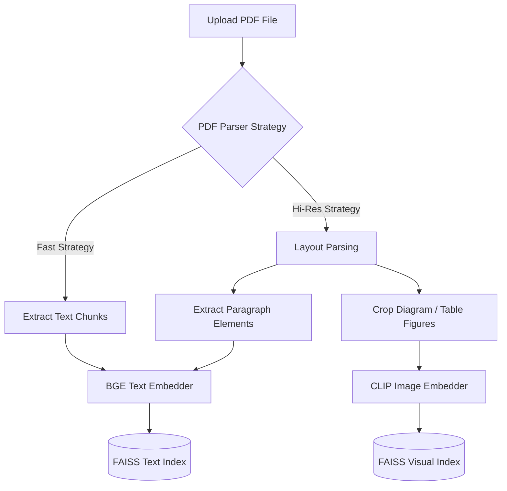
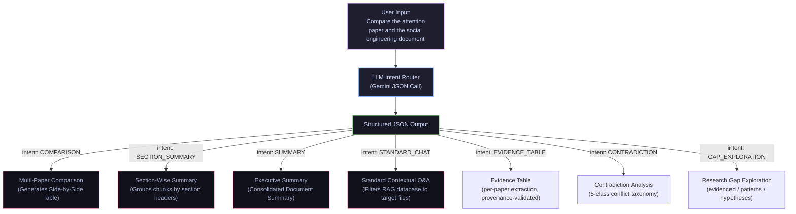
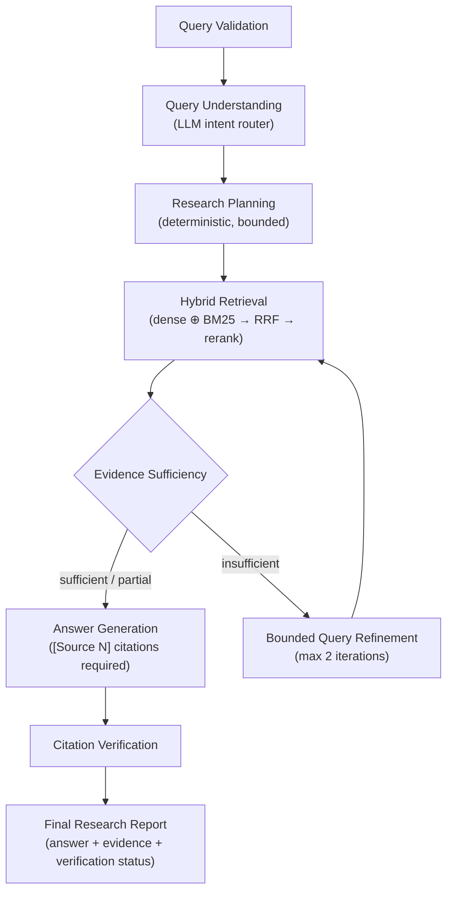

# 📚 Production-Grade Multimodal Multi-PDF Research Assistant (RAG)

A professional, modular Research Paper analysis assistant driven by **Retrieval-Augmented Generation (RAG)**. This system supports layout-aware PDF ingestion, dual-store FAISS indexing (Text + Diagrams/Charts), **hybrid dense+BM25 retrieval with Reciprocal Rank Fusion**, evidence-gated visual figure/table retrieval, cross-encoder reranking, an intelligent LLM-based query intent router, **LangGraph agentic orchestration with bounded evidence refinement**, **tool-using agentic research actions** (evidence tables, contradiction analysis, research-gap exploration), **claim-level citation verification**, and a **glassmorphism research interface** with session-isolated libraries.

> **Upgrade documentation (2026-10-28):** the agentic upgrade is documented end-to-end in [`docs/upgrade/`](docs/upgrade/) — repository audit, measured baseline, target architecture, implementation plan, evaluation results, security review, and ADRs.

---

## 📊 Results at a Glance

> **Every number below is a DEV-SET result (hold-out pending).** n=60 gold pairs,
> LLM-generated gold labels, no held-out split — see §9 Known Limitations and
> `evaluation_results.md` §8. Hold-out questions will be human-authored into `eval/holdout.jsonl`.

| Metric | n | Result | 95% CI (bootstrap) | Source | Label |
|---|---:|---|---|---|---|
| Retrieval Hit@1 (hybrid) | 60 | **60.00%** (36/60) | [46.7%, 71.7%] | [`retrieval_benchmark_hybrid_k5.json`](evaluation_suite/evaluations/retrieval_benchmark/) | dev set, hold-out pending |
| Retrieval Recall@5 (hybrid) | 60 | **91.67%** (55/60) | [83.3%, 98.3%] | same | dev set |
| Retrieval MRR (hybrid) | 60 | **0.7367** | [0.647, 0.824] | same | dev set |
| Hit@1 gain vs dense | 60 | +6.7 pp | [0.0, 15.0] — **within noise** | [`bootstrap_ci.json`](evaluation_suite/evaluations/bootstrap_ci.json) | paired test |
| Recall@5 gain vs dense | 60 | +11.7 pp | [5.0, 20.0] — significant | same | dev set, hold-out pending | paired test |
| Answer faithfulness (GLM judge) | 60 | **0.9542** | [0.906, 0.991] | [`judge_results.json`](evaluation_suite/evaluations/llm_judge/) | dev set, hold-out pending, same-family judge |
| Answer faithfulness (Gemini independent judge, full run) | 60 | **0.9803** (n=50 valid; Q15 excluded, disclosed) — agrees with GLM judge (47/50 pass/fail, mean diff 0.070) | — | [`summary_independent.json`](evaluation_suite/evaluations/llm_judge/) | dev set, hold-out pending |
| Answer relevancy | 60 | **0.8933** | [0.817, 0.955] | same as judge | dev set, hold-out pending |
| Citation-marker coverage (prompt fix) | 60→10 A/B | **0.751 full-set** (was 0.290; A/B 0.782) | — | [`rag_answers.json`](evaluation_suite/evaluations/llm_judge/) | dev set, hold-out pending |
| Fabricated citations | 60 | **0** (58 Layer-1 checked) | — | same | dev set, hold-out pending |
| Intent-routing accuracy (7 intents) | 21 | **100%** (21/21) | — | [`routing_accuracy.json`](evaluation_suite/evaluations/routing_accuracy.json) | dev set (authored), hold-out pending |
| E2E latency (median / p95) | 60 | **14.24 s / 57.92 s** | — | [`latency_report.json`](evaluation_suite/evaluations/latency_report.json) | dev set, hold-out pending · Apple M2, GLM via OpenRouter |
| **Hold-out evaluation** | — | **pending** — questions will be human-authored into `eval/holdout.jsonl` | — | [`eval/`](eval/) | not started |

---

## 🛠️ 1. System Architecture

The following diagram illustrates the hybrid RAG retrieval pipeline and visual processing flow:



### Ingestion & Parsing Strategy
1. **`hi_res` (default, only UI path):** Layout parsing with YOLOX detects structured components (headers, paragraphs, tables, images). Standalone tables and figures are cropped as separate image files — the multimodal database is always populated.
2. **`fast` (code/CLI only):** pypdf text extraction in milliseconds. Kept as an escape hatch for huge text-only dumps via `parse_pdf(path, strategy="fast")` or `config.DEFAULT_PARSE_STRATEGY`; not exposed in the UI because it silently disables the multimodal feature set.

### Chunker & Chunker-by-Title
Rather than arbitrary token length boundaries, our chunker groups text using section header titles. This prevents logical context loss (like mathematical descriptions being detached from their formulas).

### Dual-Store FAISS Database
1. **Text Store (1024-dim):** Embeds text chunks via `BAAI/bge-large-en-v1.5` on GPU/MPS into a FlatIP index.
2. **Visual Store (512-dim):** Embeds cropped layout figures via CLIP `clip-ViT-B-32`, storing visual coordinates.

### Hybrid Text Retrieval (Dense ⊕ BM25, RRF-fused)
Text retrieval runs **two complementary rankings per query** and fuses them with Reciprocal Rank Fusion (k=60) before the cross-encoder reranker:
- **Dense:** BGE query-prefix embedding → FAISS inner product.
- **Sparse:** `rank_bm25.BM25Okapi` over the same chunk registry (`src/core/sparse_retrieval.py`), catching exact lexical anchors (dataset names, metric names, "Table 3") that embeddings miss.
Measured on the 60-case gold benchmark (`docs/upgrade/evaluation_results.md`): Recall@5 **80.0% → 91.7%**, MRR **0.636 → 0.737** vs. dense-only. Toggle with `config.HYBRID_RETRIEVAL_ENABLED` (`mode="dense"` preserves the legacy path exactly).

### Visual Retrieval with Evidence Rules
Figure/table retrieval never attaches an image on a hunch. Each query gets a **relative-calibrated CLIP dense ranking** (hits within a margin of the best hit, above a noise floor) and an **IDF-weighted caption ranking** (ubiquitous tokens like "model" carry no evidence; explicit "figure 3"/"table ii" references always count). An image is returned only on **explicit reference, dense∩sparse agreement, or strong caption evidence** — otherwise zero images. `K_IMAGE_RETRIEVAL` is a cap, not a quota. A/B-measured: a query for a non-existent "Figure 1" went from 2 wrong tables to 0, while a correct table query lost its noise padding (`docs/upgrade/decisions/ADR-005.md`).

---

## 🤖 2. LLM Intent Router & Context Filtering

All incoming queries pass through an LLM-based **Intent Router** covering **7 intents** (4 chat flows + 3 agentic research actions — `EVIDENCE_TABLE`, `CONTRADICTION`, `GAP_EXPLORATION`, see [ADR-008](docs/upgrade/decisions/ADR-008-agentic-research-actions.md); measured 21/21 on the authored accuracy set). Rather than executing a blind vector similarity search, the router parses references, applies document filters, and selects the ideal execution pipeline:



---

## 🛡️ 3. High-Availability LLM Gate Architecture

To ensure zero downtime when running under restricted free-tier API quotas, all LLM requests are managed by a **Unified LLM Gate Handler**. If the primary gate fails (due to 429 quota exhaustion or rate limits), the handler dynamically redirects subsequent queries to the secondary gate without user intervention.

```mermaid
graph TD
    subgraph Client Application Layer
        AppCore["Router / Answering / Summarizer / Comparison"]
    endComplexity

    subgraph LLM Gate Layer
        AppCore -->|Unified generate call| GateHandler["LLM Gate Handler"]
        
        GateHandler -->|Gate 1| GeminiGate["Gemini Provider"]
        GeminiGate -->|429 / Quota Failure| GateHandler
        
        GateHandler -->|Gate 2: Auto Failover| ORGate["OpenRouter Provider"]
    end
    
    style AppCore fill:#1e1e2e,stroke:#cba6f7,stroke-width:2px,color:#cdd6f4
    style GateHandler fill:#181825,stroke:#89b4fa,stroke-width:2px,color:#cdd6f4
    style GeminiGate fill:#11111b,stroke:#f38ba8,stroke-width:1px,color:#a6adc8
    style ORGate fill:#11111b,stroke:#a6e3a1,stroke-width:1px,color:#a6adc8
```

---

## 🧠 4. Agentic Orchestration & Citation Verification (LangGraph)

Standard Q&A requests run through a LangGraph research graph (`src/core/agent/`) instead of a single retrieve-then-answer hop:



- **Evidence sufficiency** is deterministic: non-empty fused evidence, positive top cross-encoder logit, minimum chunk count, target-document coverage.
- **Refinement is bounded** (`AGENT_MAX_REFINEMENTS=2`) with a model-call budget (`AGENT_MODEL_CALL_BUDGET=12`) and wall-clock deadline (`AGENT_DEADLINE_SECONDS=120`); a run ID ties it all to the profiler logs.
- **Citation verification** (`src/core/verification.py`): Layer 1 (always on) resolves every `[Source N]` marker against actually-retrieved evidence and measures citation coverage; Layer 2 (opt-in, `VERIFY_CLAIMS_WITH_LLM`) asks the LLM whether cited evidence supports each claim. Answers are stamped `verified / qualified / failed` in the UI.
- **Graceful degradation:** every node captures its own failures; any graph-level failure falls back to the legacy pipeline (`AGENTIC_PIPELINE_ENABLED=False` bypasses the graph entirely). Verified by offline transition tests (`tests/test_graph.py`, 11 cases) and a live outage smoke test (`docs/upgrade/evaluation_results.md` §3).

---

## ⚠️ 5. Technical Challenges Faced & Solutions

During development, several critical concurrency, resource, and thread-safety issues were identified and resolved to make the application production-grade:

### Challenge 1: PyTorch CPU Segmentation Faults on macOS (Apple Silicon)
* **Problem:** Under heavy load, running PyTorch CPU thread-pools alongside Hugging Face `tokenizers`' native Rust multiprocessing caused a hard segmentation fault (`[1] segmentation fault python3 main.py query`) and leaked semaphore locks.
* **Solution:** 
  1. Configured `os.environ["TOKENIZERS_PARALLELISM"] = "false"` to prevent concurrent Rust-level fork conflicts.
  2. Set `torch.set_num_threads(1)` to limit PyTorch CPU thread contention.
  3. Routed BGE, CLIP, and Cross-Encoder model loading directly onto **`mps`** (Metal Performance Shaders GPU), bypassing CPU multi-threading bottlenecks and accelerating embedding times.

### Challenge 2: Streamlit Infinite Rerun Loops & 99% CPU Lockup
* **Problem:** During background ingestion, a checking fragment called `st.rerun()`. Because the clearing statement was located *after* the rerun check, the script was interrupted and entered an infinite recursive loop, locking 99.0% of a CPU core.
* **Solution:** Implemented a **Safe State Transition Pattern** where the checking fragment copies the success/error messages to `st.session_state` and **wipes the global variables immediately** *before* calling `st.rerun()`, ensuring the next execution cycle renders cleanly.

### Challenge 3: Ingestion Concurrency and Lock Deadlocks
* **Problem:** A non-reentrant database lock (`db_lock = threading.Lock()`) caused threads to deadlock when an index update failed or when nested calls tried to read registries.
* **Solution:** Audited and restructured the database modules to isolate lock acquisition strictly to the immediate read/write boundaries, wrapping updates in `try...finally` safety blocks to guarantee lock release in any failure scenario.

### Challenge 4: Multi-Paper Comparison Scale Limitations
* **Problem:** The comparative RAG engine was hardcoded to evaluate exactly two papers (`doc_a` and `doc_b`). Attempting to compare more papers ignored the remaining targets.
* **Solution:** Redesigned the Markdown table compiler and prompt constructor to support **dynamic column allocation**, accepting lists of 2 to 5+ papers and building a structured side-by-side comparative table containing equal depth for all selected targets.

### Challenge 5: Warnings Clog & UI Sluggishness
* **Problem:** Hugging Face model imports printed hundreds of megabytes of warnings about deprecated properties into the console logs, slowing down application startup and UI responses.
* **Solution:** Embedded `os.environ["TRANSFORMERS_NO_ADVISORY_WARNINGS"] = "1"` at the entry point of all model modules to suppress deprecation logs.

---

## 📊 6. Evaluation Matrix & Performance Results

Evaluation separates **deterministic, reproducible metrics** (runnable offline) from **LLM-as-judge metrics** (require API quota). Full methodology and raw outputs: [`docs/upgrade/evaluation_results.md`](docs/upgrade/evaluation_results.md).

### A. Retrieval Benchmark — Dense vs. Hybrid (deterministic, reproducible offline)

60 gold QA pairs (4 indexed papers × 15, from `evaluation_suite/dataset/gold_qa_dataset.json`); relevance = evidence-page match; rerank off; k=5; 4,722-chunk FAISS store.

```bash
rag/bin/python3 -m evaluation_suite.pipelines.run_retrieval_benchmark --mode dense  --k 5
rag/bin/python3 -m evaluation_suite.pipelines.run_retrieval_benchmark --mode hybrid --k 5
```

| Metric | Dense-only | **Hybrid (Dense ⊕ BM25, RRF)** | Δ |
|---|---:|---:|---:|
| Hit@1 | 53.33% | **60.00%** | +6.67 pp |
| Recall@5 | 80.00% | **91.67%** | +11.67 pp |
| MRR | 0.6356 | **0.7367** | +0.1011 |
| Mean latency/query (warm) | 230.0 ms | 258.6 ms | +28.6 ms |

Per-type Recall@5: text 88.9→94.4%, equation 72.2→83.3%, figure 72.2→94.4%, table 100→100%. Raw outputs live in `evaluation_suite/evaluations/retrieval_benchmark/`. *Caveat: 60 cases is a small benchmark; deltas <~10 pp are noise.*

**Absolute counts (dense → hybrid, same 60 cases):** Hit@1 **32/60 → 36/60** · Recall@3 **42/60 → 52/60** · Recall@5 **48/60 → 55/60** · MRR 0.6356 → 0.7367.

### B. Unit / Regression Suite (deterministic, reproducible offline)

```bash
rag/bin/python3 -m pytest tests/test_fusion.py tests/test_sparse_retrieval.py \
    tests/test_verification.py tests/test_graph.py tests/test_defect_fixes.py \
    tests/test_features.py tests/test_visual_ranking.py tests/test_research_actions.py -q
```

**57 passed, 0 failed** (2026-10-28, Python 3.14.4). Covers RRF fusion, BM25 ranking & cache invalidation, citation verification (Layer 1 + stubbed Layer 2), 11 LangGraph transition tests with fully stubbed LLM/retrieval, 12 visual-ranking evidence-rule tests (stray-digit, ubiquitous-token, agreement, and cap semantics), 8 agentic research-action tests (provenance guard, no-guesses rule, classification schema, budget skip, graph routing), and regression pins for fixed defects. `tests/test_rag_eval.py` (DeepEval) remains an opt-in integration test requiring live API keys.

### B2. Visual Retrieval A/B (deterministic, measured on a hi_res-ingested PDF)

Same 21-page/21-figure document, same queries, old thresholds vs. new evidence rules — full table in [`docs/upgrade/evaluation_results.md`](docs/upgrade/evaluation_results.md) §3. Headlines: "Show me Figure 1" (no such figure) went **2 wrong tables → 0**; a correct table query lost its noise padding; genuinely visual queries unchanged.

### C. LLM-as-Judge Metrics (require API quota — not included here)

Faithfulness / answer-relevancy (DeepEval, `tests/test_rag_eval.py` + `tests/run_eval.py`) and the features audit (`evaluation_suite/pipelines/run_features_audit.py`) run against live providers. During the 2026-10-28 upgrade session the Gemini free tier was quota-exhausted, so **no judge numbers are claimed**; judge-failure handling was fixed to record `UNGRADED` instead of fabricating scores.

> ⚠️ **Historical tables removed:** earlier README versions showed a "2×2 Hybrid RAG (Dense + Sparse BM25)" matrix and a "98.33% features score". Those numbers are **not reproducible from this repository** (no BM25 existed in the code; the features score depended on fabricated judge fallbacks). See `docs/upgrade/repository_audit.md` §2 (D4, D5) and `docs/upgrade/decisions/ADR-004`.

---

### D. Limitations & method (integrity audit, 2026-10-29)

- **Gold set:** questions and expected answers are **LLM-generated** (Gemini 2.5 Flash; 315 papers / 4,680 pairs; 60 used). Evidence is page-level; **no pairs were formally hand-checked**. Page-match is a proxy label.
- **Tuning-vs-test:** hybrid retrieval and the citation-prompt rewrite were evaluated on the **same 60 questions** used for reporting (the prompt A/B used the first 10). **No held-out split** — treat relative gains as partly optimistic.
- **Judges:** answers and primary judging both use GLM-5.3-Flash (not independent); Gemini 2.5 Flash cross-checked 17 pairs (0.976 vs 0.947, 16/17 agreement).
- **Latency numbers:** the 104.28 s figure is a 4-query mean on the free tier; the 17.6 s figure was a single query. The full-run measurement (60 answers, GLM) is **median 14.24 s, p95 57.92 s** on Apple Silicon (MPS).
- **"0 fabricated citations"** means markers that reference non-retrieved sources were never emitted (Layer-1 check, `verification.py`); claim-support is measured separately by faithfulness.
- **Routing 100% (21/21)** is on the authored query set; no held-out split.
- Full audit trail: [`evaluation_results.md` §8](docs/upgrade/evaluation_results.md).

## 📂 7. Project Structure

```
research-rag-assistant/
├── config.py                 # Central configurations (models, paths, feature flags, budgets)
├── main.py                   # Master CLI subcommand entry point
├── app/                      # Web dashboard application (creamy glassmorphism design system in app/theme.py)
│   ├── components/           # Modular UI widgets
│   │   ├── chat.py           # Empty state + suggestion chips, glass chat cards, verification chips
│   │   └── sidebar.py        # Upload → Library → New Session (destructive buttons removed by design)
│   └── ui.py                 # Streamlit entry point (session-isolated stores, hero + live metrics)
├── docs/
│   ├── internship_report.md  # Project report
│   └── upgrade/              # Agentic upgrade documentation (audit, baseline, architecture,
│       │                     #   implementation plan, evaluation results, security review)
│       └── decisions/        # ADR-001..004
├── src/
│   ├── core/
│   │   ├── agent/            # LangGraph research graph (state, nodes, topology)
│   │   ├── generator/        # Orchestrator, intent router, answering, summarization,
│   │   │                     #   comparison, provider gates (Gemini→OpenRouter→Ollama)
│   │   ├── ingestion.py      # PDF parsing (pypdf fast path / YOLOX hi-res)
│   │   ├── chunker.py        # Element chunking & section tagging
│   │   ├── embedder.py       # Local BGE and CLIP embedding generation
│   │   ├── sparse_retrieval.py # BM25Okapi sparse ranking over the chunk registry
│   │   ├── research_actions.py # Agentic Phase-5 tools: evidence tables, contradiction
│   │   │                     #   analysis, gap exploration (provenance-validated)
│   │   ├── visual_ranking.py   # Evidence rules for figure/table retrieval (IDF, qualification)
│   │   ├── fusion.py         # Reciprocal Rank Fusion (pure, unit-tested)
│   │   ├── verification.py   # Citation integrity checks (deterministic + optional LLM)
│   │   ├── reranker.py       # Cross-encoder reranking
│   │   └── vector_store.py   # FAISS dual index, hybrid text search, visual hybrid search
│   └── ...
├── evaluation_suite/         # Benchmarks & audit pipelines
│   ├── dataset/              # Gold QA dataset (315 papers; 60 cases benchmarked here)
│   ├── pipelines/
│   │   ├── run_retrieval_benchmark.py  # Reproducible dense-vs-hybrid benchmark
│   │   └── run_features_audit.py       # Summaries/comparisons + LLM judge (honest scoring)
│   └── evaluations/          # Benchmark outputs (retrieval_benchmark/, features_audit/)
└── tests/                    # Unit, regression, transition, and integration tests
```

---

## ⚙️ 8. Feature Flags & Configuration

All new capabilities are configured in `config.py` with safe defaults:

| Flag | Default | Effect |
|---|---|---|
| `HYBRID_RETRIEVAL_ENABLED` | `True` | Fuse BM25 sparse + BGE dense via RRF for text retrieval |
| `AGENTIC_PIPELINE_ENABLED` | `True` | Route Q&A through the LangGraph research graph |
| `AGENT_MAX_REFINEMENTS` | `2` | Max bounded retrieval-refinement iterations |
| `AGENT_MODEL_CALL_BUDGET` | `12` | Hard cap on LLM calls per query |
| `AGENT_DEADLINE_SECONDS` | `120` | Wall-clock deadline per query |
| `EVIDENCE_MIN_CHUNKS` | `2` | Sufficiency gate: minimum evidence chunks |
| `VERIFY_CLAIMS_WITH_LLM` | `False` | Layer-2 semantic citation verification (extra LLM call) |
| `JUDGE_MODEL` (env/config) | unset → rotation head | Judge with a different model family (e.g. `google/gemini-2.5-flash`); results written separately |
| `RERANK_ENABLED` | `True` | Cross-encoder reranking — always on in the UI; programmatic kill-switch |
| `DEFAULT_PARSE_STRATEGY` | `"hi_res"` | Only UI path; `"fast"` remains available programmatically |
| `K_IMAGE_RETRIEVAL` | `2` | **Max** images attached per answer (cap, not quota — fewer/zero when unqualified) |
| `IMAGE_DENSE_ABS_FLOOR` / `IMAGE_DENSE_RELATIVE_MARGIN` | `0.20` / `0.06` | CLIP dense calibration (noise floor / margin from best hit) |
| `IMAGE_SPARSE_MIN_IDF` / `IMAGE_SPARSE_STRONG_IDF` | `1.2` / `2.5` | Caption-evidence bar for sparse matches / agreement-free qualification |
| `OPENROUTER_MODELS` (env) | verified free slugs | Override the OpenRouter fallback rotation without code edits |

---

## 🚀 Deployment

Public demo: **pending** — deployment steps (Streamlit Cloud click-by-click, Docker,
local) are in [`docs/deployment.md`](docs/deployment.md). Once live, paste the URL here:
**DEMO_URL: pending**

## ⚠️ 9. Known Limitations

- **Hold-out evaluation: pending** — all reported metrics are dev-set results (n=60, LLM-generated gold, no held-out split). The scaffold is ready (`eval/`); questions will be human-authored. Next planned experiment once it exists: reranker-on vs reranker-off (the 19 wrong-rank dev failures are the clearest target).

- **Small benchmark:** retrieval metrics come from 60 gold QA pairs over 4 papers; deltas <~10 pp are noise. LLM-judge metrics were not measurable during the upgrade session (free-tier quota exhausted) and are intentionally not claimed.
- **Single-process assumptions:** model singletons, `db_lock`, and module-level state assume one Streamlit server process; multi-worker deployments are out of scope.
- **Cross-session ingestion progress:** the sidebar progress state is process-global — concurrent users see/cancel each other's ingestion status (no data corruption; stores are session-isolated).
- **Prompt-injection surface:** retrieved PDF text is not delimiting-isolated from system instructions yet (see `docs/upgrade/security_review.md` §1).
- **Ollama autostart:** the final fallback gate spawns a local `ollama serve` if available; no opt-out flag yet.
- **BM25 IDF edge:** terms matching ≥half the corpus score ≤0 and are excluded from sparse results (by design; dense retrieval covers generic terms).
- **Visual retrieval depends on caption quality:** figures with empty/OCR-poor captions can only qualify via explicit-reference patterns or dense∩sparse agreement; low-caption corpora will attach fewer images (deliberately conservative — see `docs/upgrade/decisions/ADR-005.md`).
- **Free LLM quotas:** Gemini free tier is 20 requests/day — long evaluation runs need a paid key or the local Ollama gate.
- **No destructive actions in the UI:** per-doc delete / Clear DB were removed deliberately (ADR-006); to purge a specific document, use `delete_document_from_store` from the CLI or start a New Session and let the old data auto-purge.

---

## 🛠️ 10. Setup & Execution

### Installation
1. Clone the repository:
   ```bash
   git clone https://github.com/venkatbayanaboina/research-rag-assistant.git
   cd research-rag-assistant
   ```
2. Activate your virtual environment and install requirements:
   ```bash
   source rag/bin/activate
   pip install -r requirements.txt
   ```
   > Note: if the repository folder was moved, the venv's console-script shebangs
   > (e.g. `rag/bin/pip`) point at the old absolute path. Use
   > `rag/bin/python3 -m pip <args>` instead, or recreate the venv.
3. Run anything through the plain `python3` too — the CLI self-heals:
   ```bash
   python3 main.py ui          # auto-relaunches via the bundled venv if the
   python3 main.py ingest a.pdf  # system interpreter lacks the dependencies
   ```
3. Set your environment keys:
   ```bash
   export GEMINI_API_KEY="your-gemini-key"
   export OPENROUTER_API_KEY="your-openrouter-key"
   ```

### Running the Web Dashboard
Start the Streamlit dashboard locally:
```bash
streamlit run app/ui.py
```

### Running the Evaluation Suite
**One command regenerates every reported number from raw result files** (no API): `make eval`. Live stages: `make eval-live` (~$0.20, 40–60 min). Full targets: `make test`, `make smoke`, `make bootstrap`, `make review-sheets`, `make secret-scan`, `make ci`.

Reproducible retrieval benchmark (offline):
```bash
rag/bin/python3 -m evaluation_suite.pipelines.run_retrieval_benchmark --mode hybrid --k 5
```
Unit / regression suite (offline):
```bash
rag/bin/python3 -m pytest tests/test_fusion.py tests/test_sparse_retrieval.py \
    tests/test_verification.py tests/test_graph.py tests/test_defect_fixes.py \
    tests/test_features.py tests/test_visual_ranking.py tests/test_research_actions.py -q
```
LLM-as-Judge evaluation on generated summaries/comparisons (requires API quota):
```bash
rag/bin/python3 evaluation_suite/pipelines/run_features_audit.py
```
For complete instructions, refer to **[`evaluation_suite/EVALUATION_GUIDE.md`](evaluation_suite/EVALUATION_GUIDE.md)** and **[`docs/upgrade/evaluation_results.md`](docs/upgrade/evaluation_results.md)**.
